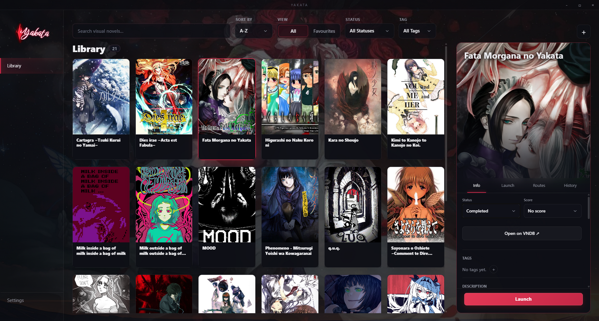

<p align="center">
  
</p>

<h1 align="center">Yakata</h1>

<p align="center">
  <a href="https://github.com/DamianEhrenburg/yakata/releases/latest">
    
  </a>
  <a href="https://github.com/DamianEhrenburg/yakata/blob/main/LICENSE">
    
  </a>
  
</p>

<p align="center">
  Visual novel library, launcher, and playtime tracker for Windows, built with Rust and Dioxus.
</p>

<p align="center">
  
</p>

<p align="center">
  
</p>

## Overview

Yakata is a desktop visual novel launcher and tracker for Windows. It catalogs your collection, pulls metadata and covers from VNDB, monitors playtime across multi-process engine wrappers, and displays Discord Rich Presence.

## Features

- Add visual novels manually or fetch metadata and cover art from VNDB
- Read synopses with expandable spoiler blocks
- Track total playtime and session logs across child processes and engine wrappers
- Launch Japanese titles with Locale Emulator (LEProc) directly from the app
- Auto-detect Shift-JIS and UTF-8 folder paths for older visual novels
- Filter and sort by reading status, 10-point personal score, favourites, and tags
- Track story routes, playtime sessions, and personal notes
- Discord Rich Presence with game status, route, and elapsed playtime
- Blur adult covers with reveal on hover
- Export and import library backups as JSON

## Download

Get the installer or portable archive from [Releases](https://github.com/DamianEhrenburg/yakata/releases/latest):

- `Yakata-Setup.exe` - Windows Installer (NSIS)
- `Yakata-Portable.zip` - Standalone portable build

## Building from Source

Requires [Rust](https://rustup.rs/) and [Dioxus CLI](https://dioxuslabs.com):

```bash
cargo install --locked dioxus-cli
dx build --release
```

## Acknowledgments

Based on [kakera](https://github.com/enotan/kakera) by [enotan](https://github.com/enotan).

## License

This project is licensed under the [MIT License](LICENSE).
